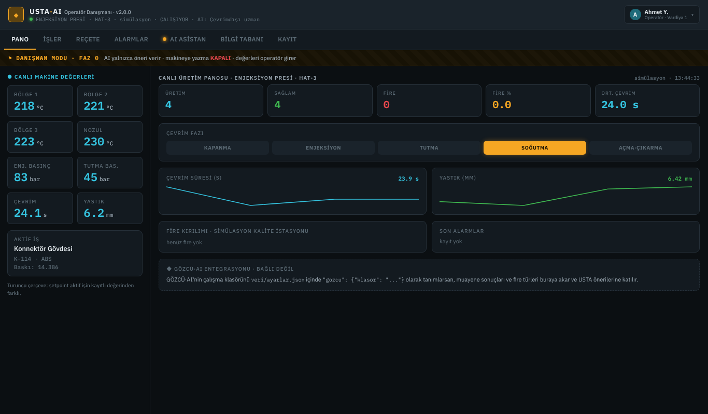
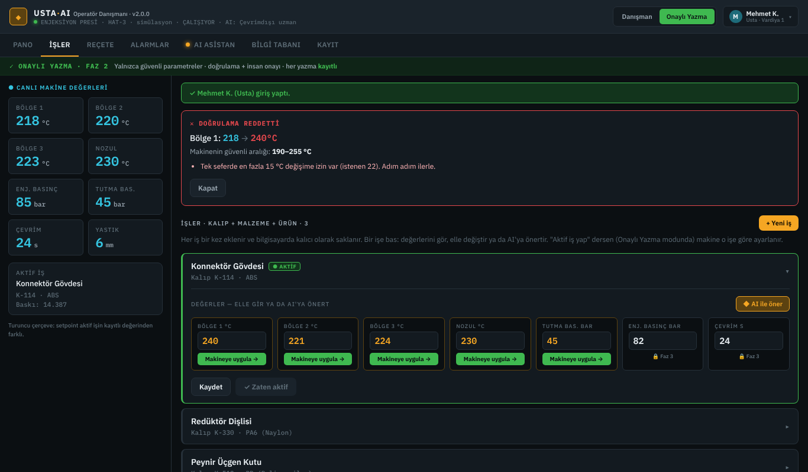

# USTA·AI — Enjeksiyon Presi Operatör Danışmanı

**AI önerir, insan onaylar, makine korunur.**

USTA·AI, plastik enjeksiyon presinin **yanında** çalışan yapay zekâ destekli bir
operatör danışmanıdır. Makinenin HMI'ına girmez; makineyi dinler, canlı değerleri
ve tesisin kendi belgelerini birlikte yorumlar, hata ve ayar konusunda Türkçe
saha diliyle öneri verir. Makineye değer yazmak **her zaman** doğrulama + insan
onayı + değiştirilemez kayıt gerektirir.



## Neler yapar

| | |
|---|---|
| **PANO** | Canlı üretim, sağlam/fire, çevrim fazı, çevrim ve yastık trendi, fire kırılımı, son alarmlar |
| **AI ASİSTAN** | "Kenarlarda çapak var" deyin; canlı değerlere ve tesis kayıtlarına dayanan sıralı kontrol listesi + güvenli aralıkta küçük adımlı ayar önerisi |
| **ALARMLAR** | Alarm, ölçülen değerden **kendiliğinden** doğar; USTA yorumunu kendisi getirir, koşul kalkınca alarm kapanır |
| **İŞLER** | Kalıp + malzeme + ürün kütüphanesi, kalıcı; tek tuşla işe geçiş (onaylı yazma modunda) |
| **REÇETE** | Yeni ürün için başlangıç ayarı: önce tesisin kanıtlı reçetesi, yoksa genel tablo |
| **BİLGİ TABANI** | Word, Excel, CSV, metin (ve `pypdf` ile PDF) belgeleri **gerçekten okunur**, onaylanan kayıtlar önerilere girer |
| **KAYIT** | Makineye yazılan her değer, kaynağı ve onaylayanıyla; veritabanı seviyesinde **silinemez/değiştirilemez** |

## Hızlı başlangıç

Tek gereksinim **Python 3.9 veya üstü**. Başka paket kurmanız **gerekmez**;
arayüz, yazı tipleri ve React dahil her şey depoda gelir, internet olmadan çalışır.

### Windows
1. [python.org/downloads](https://www.python.org/downloads/) adresinden Python'u kurun.
   Kurulumun ilk ekranında **"Add Python to PATH"** kutusunu işaretleyin.
2. Bu depoyu indirin (GitHub'da **Code → Download ZIP**) ve bir klasöre çıkarın.
3. **`baslat.bat`** dosyasına çift tıklayın. Panel tarayıcıda kendiliğinden açılır.

Sorun yaşarsanız önce **`kontrol.bat`** çalıştırın; neyin eksik olduğunu söyler.

### macOS / Linux / Raspberry Pi
```bash
git clone <depo-adresi> usta-ai
cd usta-ai
./baslat.sh            # ya da: python3 -m usta
```

Panel adresi: **http://127.0.0.1:8080** (port doluysa sonraki boş port seçilir, pencerede yazar).

## Yapay zekâ kaynağı — üç seçenek

| Kaynak | Ne gerekir | Ne zaman |
|---|---|---|
| **Çevrimdışı uzman** (varsayılan) | Hiçbir şey | İnternet/anahtar yoksa. Kural tabanlı enjeksiyon sorun-giderme bilgisi + canlı değerler + güvenli aralıklar |
| **Claude (bulut)** | Claude API anahtarı | En iyi dil anlama ve serbest soru-cevap |
| **Yerel model (Ollama)** | [Ollama](https://ollama.com) + bir model | Veri tesisten hiç çıkmasın istendiğinde |

Claude'u açmak için `.env.example` dosyasını **`.env`** adıyla kopyalayıp anahtarınızı yazın:

```ini
ANTHROPIC_API_KEY=sk-ant-...
```

`.env` dosyası `.gitignore`'dadır; anahtarınız GitHub'a yüklenmez. Bulut AI'ya
ulaşılamazsa (internet kesildi, kota doldu) panel boş kalmaz: cevap çevrimdışı
uzmandan gelir ve bu, cevabın üstünde **"yedek"** olarak işaretlenir.

## Güvenlik modeli



- Program her açılışta **Danışman modunda** ve **Operatör** rolüyle başlar.
  Danışman modunda makineye hiçbir değer yazılmaz (iş değişimi dahil).
- **Onaylı Yazma** modunu yalnız *Usta* ve *Mühendis* açabilir.
- Her yazma isteği doğrulama kapısından geçer: alan yazılabilir mi (kritik
  parametreler kilitli), makinenin güvenli aralığında mı, **tek adımda en fazla**
  izin verilen değişim aşılıyor mu, rol ve mod uygun mu.
- Geçen istek 90 saniyelik **tek kullanımlık onay belirteci** alır; onay anında
  rol ve mod yeniden denetlenir.
- Her yazma kayıt defterine düşer; kayıt defteri SQLite tetikleyicileriyle
  korunur, **güncellenemez ve silinemez**.
- Yapay zekânın ürettiği sayılar doğrudan makineye gitmez: önce süzülür, aralık
  dışındakiler kırmızıyla işaretlenir ve yazılamaz.
- Yerel sunucu yalnız bu bilgisayardan erişilir; durum değiştiren her istek özel
  bir başlık ister (başka bir web sitesi tarayıcınız üzerinden makineye istek
  atamaz) ve Host başlığı denetlenir.

Güvenli aralıklar ve tek-adım sınırları `veri/ayarlar.json` içinden, **o makinenin**
değerlerine göre ayarlanmalıdır.

## Tablet / panel bağlantısı

Aynı ağdaki bir tabletten kullanmak için **`tablet_icin_baslat.bat`**
(ya da `python -m usta --ag`). Pencerede tabletin açacağı adres yazar.
Ağ erişimi açıkken rol PIN'lerini mutlaka tanımlayın:

```json
"roller": { "pin": { "operator": "", "usta": "2468", "muhendis": "1357" } }
```

## GÖZCÜ·AI ile bağlantı (göz + akıl)

[GÖZCÜ·AI](../gozcu-ai) görüntü işleme kalite kontrolünün çalışma klasörünü
gösterin; muayene sonuçları ve fire türleri PANO'ya akar, AI ASİSTAN
"fire neden arttı?" sorusunu bu veriyle birlikte yanıtlar:

```json
"gozcu": { "klasor": "C:\\Users\\kullanici\\Desktop\\gozcu-ai" }
```

USTA, GÖZCÜ dosyalarını yalnızca **okur**.

## Gerçek prese bağlanma (OPC UA)

Varsayılan bağlantı fiziksel modelli **simülatördür** (sıcaklıklar rampa yapar,
fire türü süreç sapmasından doğar, arıza senaryoları alarm üretir). Gerçek pres
için `pip install asyncua` ve `veri/ayarlar.json`:

```json
"makine": {
  "baglanti": "opcua",
  "opcua_url": "opc.tcp://192.168.0.10:4840",
  "opcua_dugumler": {
    "z1": "ns=2;s=Barrel.Zone1.Actual", "z1_sp": "ns=2;s=Barrel.Zone1.Setpoint",
    "tutmaPress": "...", "tutmaPress_sp": "...", "enjPress": "...",
    "cevrim": "...", "yastik": "...", "baski": "...",
    "yazma_izni": false
  }
}
```

Bağlantı varsayılan olarak **salt okunurdur**. Yazma yalnız `"yazma_izni": true`
ile açılır; her yazmadan sonra değer makineden **geri okunarak** doğrulanır.
Pres kapanıp açılırsa USTA kendiliğinden yeniden bağlanır.
Düğüm adları üreticiye özeldir — makinenin OPC UA belgesine bakın.

## Proje yapısı

```
usta/                 Python paketi (yalnız standart kütüphane)
  __main__.py         komut satırı: başlat / kontrol
  app.py              iş mantığı (oturum, yetki, işler, yazma akışı)
  server.py           yerel HTTP sunucusu ve REST API
  safety.py           doğrulama kapısı + onay belirteçleri
  storage.py          SQLite (değiştirilemez kayıt defteri dahil)
  knowledge.py        bilgi tabanı: getirme + belge ayrıştırma
  ai/                 AI aracısı: Claude, Ollama, çevrimdışı uzman
  machine/            makine bağdaştırıcıları: simülatör, OPC UA
  gozcu_bridge.py     GÖZCÜ·AI okuyucu
  web/                derlenmiş arayüz (React + yazı tipleri yerel)
arayuz/               arayüz kaynağı (app.jsx) + derleyici — yalnız geliştirici
tests/                otomatik testler
docs/                 belgeler (kurulum, donanım, teknik rapor, sunum…)
veri/                 çalışma verisi: ayarlar.json, usta.db, usta.log (depoya girmez)
```

## Geliştirme

```bash
pip install -r requirements-dev.txt
python -m pytest            # tüm testler (OPC UA testi gerçek bir yerel sunucu kurar)

# arayüzü değiştirdiyseniz:
cd arayuz && npm install && npm run build   # usta/web/app.js yeniden üretilir
```

GitHub'a her yüklemede testler Windows, macOS ve Linux'ta, Python 3.9/3.11/3.13
ile otomatik koşar (`.github/workflows/test.yml`).

## Sorun giderme

| Belirti | Çözüm |
|---|---|
| `baslat.bat` "Python bulunamadı" diyor | Python'u kurarken "Add Python to PATH" işaretli olmalı; yeniden kurun |
| Panel açılmadı | Penceredeki adresi tarayıcıya elle yazın |
| AI "yedek" diyor | `kontrol.bat` çalıştırın: anahtar/internet/kota sorununu yazar |
| Port dolu | Program sonraki boş portu seçer; ya da `python -m usta --port 8090` |
| Ayarlar bozuldu | `veri/ayarlar.json` dosyasını silin; ilk açılışta yeniden oluşur |

Ayrıntılı kılavuzlar: [docs/](docs/)

## Lisans

Ticari yazılım — bkz. [LICENSE](LICENSE). Kodu herkese açık bir GitHub deposuna
koyarsanız herkes görebilir; satmayı planlıyorsanız deponuzu **Private** yapın.
