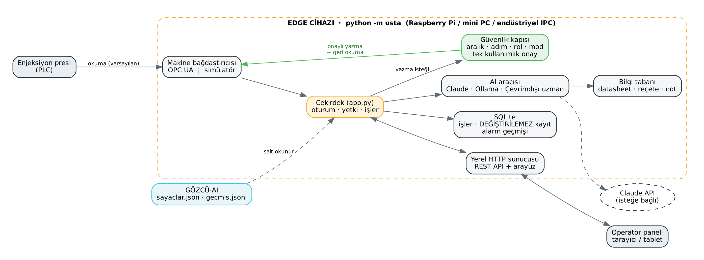
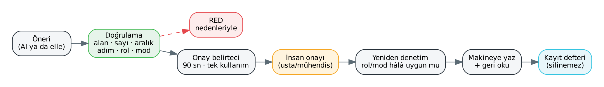

# USTA·AI — Teknik Detay Raporu

Mimari, bileşenler, veri akışı, yapay zekâ katmanı, güvenlik ve test kapsamı.

> **Hedef kitle:** teknik değerlendirme yapacak mühendis ya da karar verici.

## 1 · Mimari

USTA, makinenin içine girmeyen, yanında çalışan bir danışmandır. Tek bir Python sürecidir (`python -m usta`): makineyi dinler, yorumlar, kaydeder ve operatör paneline yerel bir HTTP sunucusuyla hizmet verir.

## 2 · Bileşenler

| Bileşen | Dosya | Görev |
|---|---|---|
| Komut satırı | `usta/__main__.py` | Başlatma, port seçimi, tarayıcıyı açma, `kontrol` tanılaması |
| Yapılandırma | `usta/config.py` | Varsayılanlar + `veri/ayarlar.json` + `.env` + ortam değişkenleri; geçersiz değerleri düzeltir ve uyarır |
| Çekirdek | `usta/app.py` | Oturum ve roller, işler, onaylı yazma akışı, bilgi tabanı işlemleri; HTTP'den bağımsız |
| Sunucu | `usta/server.py` | REST API ve arayüz dosyaları; CSRF ve Host başlığı denetimi |
| Güvenlik kapısı | `usta/safety.py` | Aralık, tek adım, rol, mod, kilitli alan denetimi; tek kullanımlık onay belirteci |
| Depolama | `usta/storage.py` | SQLite: işler, değiştirilemez kayıt defteri, bilgi tabanı, sonuçlar, alarm geçmişi |
| Bilgi tabanı | `usta/knowledge.py` | Kayıt getirme ve Word/Excel/CSV/metin/PDF ayrıştırma |
| AI aracısı | `usta/ai/` | Claude, Ollama ve çevrimdışı uzman; hata durumunda uzmana düşme |
| Makine | `usta/machine/` | Bağdaştırıcı arayüzü; simülatör ve OPC UA uygulamaları |
| GÖZCÜ köprüsü | `usta/gozcu_bridge.py` | GÖZCÜ'nün sayaç ve geçmiş dosyalarını salt okur |
| Arayüz | `arayuz/app.jsx` → `usta/web/` | React; derlenmiş hâli depoda, çalışırken internet gerekmez |

## 3 · Makine bağdaştırıcısı

Sunucu yalnız `MachineAdapter` arayüzünü bilir: `snapshot`, `alarms`, `ack_alarm`, `write_setpoint`, `load_job`. Yeni bir protokol (Modbus TCP, üreticiye özel arayüz) eklemek bu sınıfı uygulamak demektir; uygulamanın geri kalanı değişmez.

### 3.1 · Simülatör

Rastgele sayı üreteci değil, küçük bir süreç modelidir:

- Kovan bölgeleri setpoint'e **birinci derece gecikmeyle** yaklaşır; değer değiştirilince sıcaklık zıplamaz, rampa yapar.
- Enjeksiyon basıncı eriyik sıcaklığına bağlıdır: soğuk eriyik daha yüksek basınç ister.
- Fire olasılığı süreç sapmasından doğar ve türü sapmaya göre seçilir (sıcak + yüksek tutma → çapak; soğuk + düşük tutma ya da boş huni → eksik dolum).
- Alarmlar sabit bir listeden değil, **ölçülen değerlerdeki koşullardan** doğar; 2 saniyeden kısa sapma alarm üretmez, koşul kalkınca alarm kendiliğinden kapanır.
- Arıza senaryoları (rezistans arızası, huni boşalması, yağ soğutması, kalıp koruma) fiziksel etki olarak eklenir; alarm, verideki etkiden çıkar.

### 3.2 · OPC UA

`asyncua` kütüphanesiyle bağlanır, düğümleri periyodik okur. Varsayılan **salt okunurdur**. Yazma açıksa her yazmadan sonra değer makineden **geri okunur**; uyuşmazsa hata verilir. Bağlantı koparsa durum "BAĞLANTI HATASI" olur ve artan bekleme ile (en çok 10 sn) kendiliğinden yeniden bağlanılır.

## 4 · Onaylı yazma akışı

1. Öneri (yapay zekâdan ya da elle) doğrulama kapısına gelir.
2. Kapı şunları denetler: alan tanımlı ve yazılabilir mi, değer sonlu bir sayı mı, makinenin güvenli aralığında mı, mevcut değerden tek adımda izin verilenden fazla mı uzaklaşıyor, kullanıcının rolü yazmaya yetkili mi, panel yazma modunda mı.
3. Geçen isteğe **90 saniyelik, tek kullanımlık** bir onay belirteci verilir.
4. İnsan onaylayınca rol ve mod **yeniden** denetlenir (bu arada vardiya değişmiş olabilir).
5. Değer makineye yazılır; kayıt defterine kim, ne zaman, hangi değerden hangi değere, hangi kaynakla (AI önerisi, reçete, elle) düşer.

İş değişimi (aktif iş yapma) danışman modunda makineye hiçbir şey yazmaz; yazma modunda ise tüm değerler güvenli aralıkta değilse iş yüklenmez ve her değişen alan ayrı kayıt olur.

## 5 · Yapay zekâ katmanı

| Sağlayıcı | Nasıl | Ne zaman |
|---|---|---|
| Claude | Messages API (`x-api-key`, `anthropic-version: 2026-10-21`) | Anahtar tanımlıysa |
| Ollama | `POST /api/chat`, yerel | `USTA_AI=ollama` |
| Çevrimdışı uzman | Kural tabanı + canlı değerler + güvenli aralıklar | Varsayılan ve yedek |

Her istekte modele şunlar verilir: canlı makine değerleri ve setpoint'ler, **makinenin güvenli aralıkları**, ilgili tesis kayıtları ve (bağlıysa) GÖZCÜ fire verisi. Sağlayıcı hata verirse cevap çevrimdışı uzmandan gelir ve panelde "yedek" olarak işaretlenir — operatör hiçbir zaman boş ekranla kalmaz.

Reçete önerilerinde model yalnız JSON döndürmeye yönlendirilir; çıktı süzülür (bilinmeyen alanlar atılır, metin sayılar sayıya çevrilir). **Aralık dışı değerler düzeltilmez, kırmızıyla işaretlenir ve yazılamaz** — insan neyin yanlış olduğunu görmelidir.

### 5.1 · Çevrimdışı uzman

Dil modeli değildir. Çapak, eksik dolum, çöküntü, gümüşleme, yanık, çarpılma, kabarcık, akış izi, kalıba yapışma ve çevrim kısaltma için sebep listeleri, sıralı kontrol listeleri ve ayar yönleri içerir; bunları canlı setpoint'lerle birleştirip **güvenli aralıkla sınırlanmış küçük adımlar** önerir. Alarm türleri (sıcaklık, basınç, yağ, huni, kalıp koruma) için de kontrol listeleri vardır. Reçetede önce tesisin kanıtlı reçetesini, yoksa genel malzeme tablosunu kullanır ve et kalınlığına göre düzeltir.

## 6 · Bilgi tabanı

- **Getirme:** sorgu kelimeleriyle kayıt kelimelerinin örtüşmesi; malzeme eşleşmesi yalnız ek puan verir. Kelime örtüşmesi olmayan kayıt getirilmez (alakasız datasheet eklenmez). Alarm yorumlarında yalnız makine notları kullanılır.
- **Ayrıştırma:** Word ve Excel dosyaları standart kütüphaneyle (ZIP + XML) okunur; CSV'de ayraç ve Türkçe kodlama (cp1254) otomatik bulunur; PDF için `pypdf` gerekir. Metin bölümlere ayrılır, malzeme ve tür (reçete / datasheet / not) tahmin edilir. **Kayıtlar önce kullanıcıya gösterilir, onaylananlar eklenir.**

## 7 · Kalıcılık

Tek dosyalık SQLite (`veri/usta.db`, WAL modu). Kayıt defteri tablosunda `BEFORE UPDATE` ve `BEFORE DELETE` tetikleyicileri işlemi **reddeder**: yazılım hatası olsa bile geçmiş değiştirilemez. Panel her açılışta danışman modunda ve operatör rolüyle başlar; bu bilerek kalıcı tutulmaz.

## 8 · Sunucu güvenliği

- Varsayılan dinleme adresi `127.0.0.1`: yalnız bu bilgisayar erişir. `--ag` ile ağ açılır.
- Durum değiştiren her istek `X-Usta: 1` başlığı ister: başka bir web sitesi kullanıcının tarayıcısı üzerinden istek atamaz (CSRF).
- Yerel modda `Host` başlığı denetlenir (DNS-rebinding'e karşı).
- Statik dosyalar yalnız `usta/web` altından verilir; yol kaçışı engellenir.
- İstek gövdesi 15 MB ile sınırlıdır; beklenmeyen hatalar kullanıcıya iç ayrıntı göstermeden `veri/usta.log`'a yazılır.

## 9 · Test kapsamı

`python -m pytest` ile koşan **69 otomatik test**:

| Alan | Örnekler |
|---|---|
| Yapılandırma | `.env` okuma, bozuk `ayarlar.json`, geçersiz sağlayıcı/aralık, anahtarın dosyaya yazılmaması |
| Güvenlik kapısı | 8 ret senaryosu, belirtecin tek kullanımlığı ve süresinin dolması, AI çıktısının süzülmesi |
| Depolama | Kayıt defterinin güncellenememesi ve silinememesi |
| Simülatör | Rampa, arızanın alarm doğurup kendiliğinden kapanması, gürültünün alarm üretmemesi, fire türünün süreçten gelmesi |
| AI | Sahte sunucuyla Claude ve Ollama istek biçimi (temperature gönderilmediği dahil), 401 hatası, uzmana düşme, bozuk JSON |
| Uzman | 6 kusur teşhisi, güvenli aralıkta öneri, düşük yastık uyarısı, PC reçetesinde aralık uyarısı |
| Belgeler | Word, Excel, CSV (cp1254) ayrıştırma ve anlaşılır hata mesajları |
| HTTP | CSRF, Host, yol kaçışı, tam yazma akışı, onay anında rol değişimi, PIN, iş yaşam döngüsü, alarm ve belge akışları |
| OPC UA | Gerçek yerel OPC UA sunucusuna karşı okuma, salt-okuma koruması, geri-okumalı yazma, kopma ve **kendiliğinden yeniden bağlanma** |
| Arayüz | Gerçek Chromium tarayıcıda ana akışlar ve konsol hatası olmaması |

GitHub Actions her yüklemede testleri Windows, macOS ve Linux'ta Python 3.9, 3.11 ve 3.13 ile koşar; ayrıca depodaki derlenmiş arayüzün kaynakla aynı olduğunu denetler.

## 10 · Bilinen sınırlar

- OPC UA alarm etiketleri üreticiye özeldir; eşlemesi henüz yapılandırılabilir değildir (simülatörde alarmlar tamdır).
- Kullanıcı rolleri yerel bir panel için tasarlanmıştır (PIN). Çok kullanıcılı, merkezi kimlik doğrulama (LDAP/AD) yoktur.
- Çevrimdışı uzman dil modeli değildir; serbest biçimli sorularda yalnız bildiği konular için yanıt verir.
