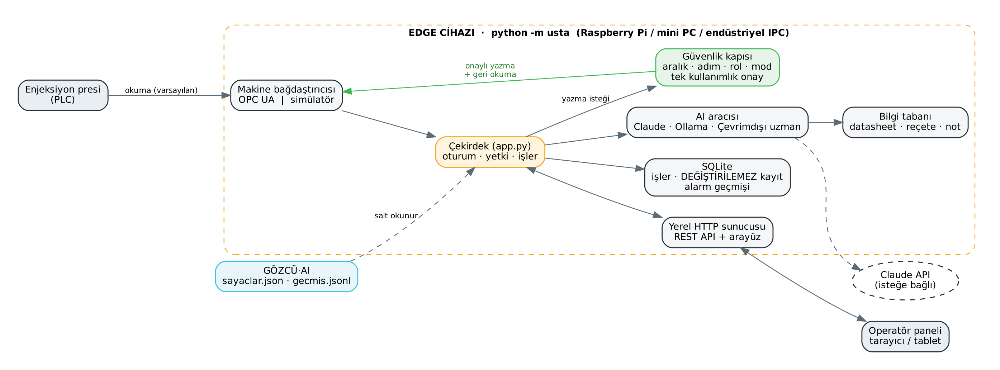

# USTA·AI — Mimari ve Yol Haritası

Ürün fikri, tasarım ilkeleri, bugün nerede olduğu ve sahaya çıkışa kadar izlenecek yol.

## 1 · Sorun

- Karmaşık HMI ekranları, işi yeni öğrenen operatöre uçak kokpiti gibi gelir; yanlış değer girme korkusu üretimi yavaşlatır.
- Ustanın bilgisi kişiye bağlıdır; usta ayrılınca ya da vardiya değişince kaybolur.
- Makine alarm verdiğinde yeni operatör ne yapacağını bilemez; hat durur.
- Her ürün değişiminde doğru ayarı bulmak deneme-yanılma ve fire demektir.

## 2 · Çözüm

Makinenin yanında duran bir **dijital usta**: makineyi dinler, tesisin kendi belgelerini bilir, operatörün sorusunu sade dille yanıtlar, alarmın sebebini ve sıralı kontrol listesini kendiliğinden getirir, yeni ürün için başlangıç ayarı önerir.

## 3 · Tasarım ilkeleri

1. **AI önerir, insan onaylar, makine korunur.** Yapay zekâ makineye hiçbir zaman doğrudan yazmaz.
2. **Makinenin içine girilmez.** HMI'a ve PLC programına dokunulmaz; garanti riski oluşmaz.
3. **Varsayılan salt okuma.** Yazma, bilerek ve kademeli açılır.
4. **Zarif düşüş.** İnternet, bulut ya da yapay zekâ olmadan da panel çalışır; makine USTA olmadan da çalışır.
5. **Tesis verisi önce gelir.** Kanıtlı tesis reçetesi genel bilgiden üstündür ve bunu kullanıcı görür (● TESİS VERİSİ / ○ GENEL BİLGİ).
6. **Her yazma izlenebilir.** Değiştirilemez kayıt defteri.

## 4 · Yazma seviyeleri

| Seviye | Ad | Ne olur | Durum |
|---|---|---|---|
| Faz 0 | Danışman | Yalnız öneri; değerleri operatör makine ekranına girer | Varsayılan |
| Faz 2 | Onaylı yazma | Güvenli parametreler, doğrulama + insan onayı + geri okuma + kayıt | Uygulandı |
| Faz 3 | Kritik parametreler | Enjeksiyon basıncı, çevrim gibi alanlar | Kilitli; sahada ayrıca değerlendirilecek |

## 5 · Mimari

Ayrıntı: [03_Teknik_Detay_Raporu](03_Teknik_Detay_Raporu.md).

## 6 · Bugün nerede? (v2.0)

| Yetenek | Durum |
|---|---|
| Yerel uygulama, kurulumsuz çalışma (Windows/macOS/Linux/Pi) | Tamam |
| Fiziksel modelli simülatör, arıza senaryoları | Tamam |
| Yapay zekâ: Claude / Ollama / çevrimdışı uzman + yedekleme | Tamam |
| Onaylı yazma, doğrulama kapısı, değiştirilemez kayıt | Tamam |
| İş kütüphanesi, reçete önerisi, deneme sonuçları | Tamam |
| Gerçek belge ayrıştırma (Word, Excel, CSV, PDF) | Tamam |
| OPC UA okuma/yazma, geri okuma, yeniden bağlanma | Test sunucusunda doğrulandı; gerçek preste denenmedi |
| GÖZCÜ·AI köprüsü | Tamam (dosya tabanlı) |
| 69 otomatik test, çoklu platform CI | Tamam |

## 7 · Yol haritası

| Aşama | İçerik | Çıkış ölçütü |
|---|---|---|
| 1 · Dost fabrika pilotu | Tek pres, OPC UA salt okuma, çevrimdışı uzman veya Claude | Bir hafta boyunca panel değerleri = makine ekranı; operatör geri bildirimi |
| 2 · Alarm eşlemesi | Makinenin alarm etiketlerini OPC UA'dan okuma | Gerçek alarmların USTA'da göründüğü ve yorumlandığı |
| 3 · Onaylı yazma pilotu | Üretici onayı + güvenlik değerlendirmesi sonrası tek parametre (tutma basıncı) | Kayıt defterinde sorunsuz bir ay |
| 4 · GÖZCÜ ile kapalı döngü | Fire türü artışında USTA'nın öneriyi kendiliğinden getirmesi | Fire oranında ölçülebilir düşüş |
| 5 · Çok makine | Merkezi pano, makineler arası karşılaştırma | 3+ makine |
| 6 · Ürünleşme | Kurulum paketi (Pi imajı), lisanslama, uzaktan güncelleme | İlk ücretli müşteri |

## 8 · Riskler

| Risk | Önlem |
|---|---|
| Makinenin OPC UA'sı kapalı / lisanslı | Pilot öncesi makine envanteri; üreticiyle görüşme |
| Yanlış öneri | Doğrulama kapısı, güvenli aralık, küçük adım, insan onayı, tesis verisi önceliği |
| Bulut kesintisi | Çevrimdışı uzman yedeği |
| Veri gizliliği | Yerel model (Ollama) ya da çevrimdışı uzman seçeneği |
| Ortam (toz, ısı) | Pilot sonrası endüstriyel donanıma geçiş |
