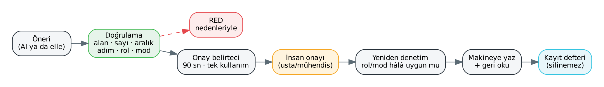

# USTA·AI — Güvenlik ve Kurulum Güvencesi

İşletmeci ve bakım sorumlusu için: USTA makineye ne yapabilir, ne yapamaz ve bu nasıl garanti altına alınır.

> **Tek cümle:** USTA varsayılan olarak yalnız dinler. Makineye bir değer yazılabilmesi için yedi ayrı koşulun **aynı anda** sağlanması gerekir ve her yazma silinemez biçimde kaydedilir.

## 1 · USTA'nın yapamadıkları

- Makinenin HMI ekranına, PLC programına ya da güvenlik devrelerine **giremez**. Acil stop, kapı kilitleri, kalıp koruması makinenin kendisindedir ve USTA bunlara erişmez.
- Danışman modunda makineye **hiçbir değer yazamaz** — iş değişimi dahil.
- Kritik parametreleri (enjeksiyon basıncı, çevrim süresi) **yazamaz**; bunlar kilitlidir.
- Makinenin güvenli aralığı dışında bir değeri, kim isterse istesin **yazamaz**.
- Kayıt defterindeki bir satırı **silemez ve değiştiremez** (veritabanı reddeder).

## 2 · Bir yazmanın gerçekleşmesi için gereken yedi koşul

1. OPC UA ayarında yazma bilerek açılmış olmalı (`"yazma_izni": true`; varsayılan kapalı).
2. Oturumdaki kullanıcı **Usta** ya da **Mühendis** olmalı (PIN tanımlıysa doğru PIN ile).
3. Panel **Onaylı Yazma** moduna alınmış olmalı (her açılışta Danışman moduyla başlar).
4. Alan yazılabilir olmalı (kritik parametre değil).
5. Değer makinenin **güvenli aralığında** olmalı.
6. Değişim **tek adım sınırını** aşmamalı (ör. sıcaklıkta 15 °C).
7. İnsan, 90 saniye içinde **onaylamalı**; onay anında 2. ve 3. koşul yeniden denetlenir.

Yazmadan sonra değer makineden **geri okunur**; uyuşmazsa hata verilir ve operatör uyarılır.

## 3 · Yapay zekâ ne kadar güvenilir?

- Yapay zekâ **öneri** üretir; önerilen sayılar doğrudan hiçbir yere gitmez, önce süzülür ve doğrulama kapısından geçer.
- Aralık dışı öneriler **düzeltilmez, kırmızıyla gösterilir** ve yazılamaz — insan, modelin nerede yanıldığını görür.
- Modele her istekte makinenin güvenli aralıkları verilir ve sınırları aşmaması söylenir; buna rağmen aşarsa kapı durdurur.
- Bulut yapay zekâya ulaşılamazsa cevap kural tabanlı çevrimdışı uzmandan gelir ve "yedek" olarak işaretlenir.
- Kişi güvenliği gerektiren işlerde (kalıba el sokma, ısıtıcıya dokunma) öneriler önce makineyi güvenli moda almayı söyler.

## 4 · Ağ ve veri güvenliği

| Konu | Uygulama |
|---|---|
| Erişim | Varsayılan yalnız aynı bilgisayardan (127.0.0.1); tablet için ağ erişimi bilerek açılır |
| Rol PIN'leri | `veri/ayarlar.json`; ağ erişimi açıksa doldurulmalı |
| Tarayıcı üzerinden saldırı | Durum değiştiren her istek özel başlık ister (CSRF koruması); Host başlığı denetlenir |
| API anahtarı | Yalnız `.env` dosyasında; `.gitignore`'da, ayar dosyasına yazılmaz |
| Buluta giden veri | Yalnız Claude seçiliyse: soru, canlı değerler, ilgili tesis kayıtları. Yerel model ya da uzman seçilirse hiçbir veri dışarı çıkmaz |
| Kayıtlar | `veri/usta.db` yerel dosyada; yedeklenmesi tesisin sorumluluğundadır |

## 5 · Kurulum güvencesi — sahada izlenecek sıra

1. **Envanter:** makinenin OPC UA desteği, düğüm listesi, alarm etiketleri, setpoint etiketleri.
2. **Salt okuma (en az 1 hafta):** panel değerleri makine ekranıyla birebir mi? Alarmlar doğru mu?
3. **Güvenli aralıkların girilmesi:** makine ve kalıp için `aralik` ve `max_adim` değerleri, tesisin mühendisi tarafından.
4. **PIN'lerin tanımlanması** ve rollerin kişilere verilmesi.
5. **Güvenlik değerlendirmesi:** yazma açılmadan önce bağımsız fonksiyonel güvenlik değerlendirmesi (makine emniyeti uzmanı).
6. **Tek parametreyle yazma pilotu** (ör. tutma basıncı), kayıt defteri haftalık incelenerek.
7. Ancak sonra diğer parametreler, birer birer.

## 6 · Sorumluluk sınırı

USTA bir **karar destek** aracıdır. Makinenin güvenli işletiminden makinenin emniyet sistemleri ve işletmenin prosedürleri sorumludur. USTA hiçbir emniyet fonksiyonunun yerine geçmez ve geçecek şekilde kullanılmamalıdır.
